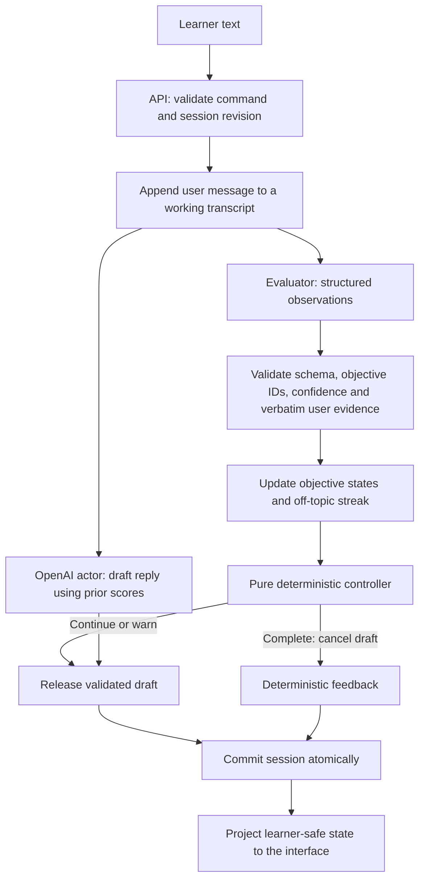

# Architecture and data flow

The engine is TypeScript plus Zod. It depends on `ConversationActor` and `ObjectiveEvaluator` interfaces, not a model SDK or a web framework. Scenario definitions are parsed on load. The fake and OpenAI adapters implement the same contracts.

## Separation of responsibilities

The actor creates plausible customer replies. It cannot invoke tools or mutate session state. The evaluator judges cumulative learner behavior and classifies only the latest turn for off-topic status and serious safety violations. Its Zod schema has no termination command. The controller decides whether to continue. OpenAI starts the actor alongside evaluation, using the latest transcript and prior-turn scores. A reply is withheld until evaluation and controller checks permit continuation. Completion or evaluation failure aborts the draft request and discards any result; late rejections are consumed. An unused draft can still incur API charges. The fake provider remains sequential because its scripted actor relies on updated scores. Feedback uses validated stored assessments and quotes without another model call.

The route receives only `start`, `turn`, or `end`, with a revision and message when relevant. Client-provided state, scores, scenario definitions, and arbitrary extra command fields are rejected. A random HTTP-only SameSite cookie identifies the session. Cross-origin POSTs are rejected when an Origin header is present. This is local session isolation, not authentication.

## Scenario authoring and persistence

The server-rendered `/scenarios` library reads the built-in definition and validated JSON records through `scenario-repository.ts`. The builder uses the same authoring schema as the POST/PUT API: all categories need complete 0/50/100 rubrics and at least one must be required. Saves derive evaluator examples from the rubric, assign new IDs on creation, check revisions on edits, and atomically replace files. A process-local queue serializes writes. The built-in sample can be copied but not overwritten.

Starting a session accepts a scenario ID, loads the server-owned definition, and stores a deep snapshot alongside session state. Every subsequent turn, completion, and learner projection uses that snapshot. Scenario edits cannot change an active session's categories or scores. The learner response exposes scene context; detailed rubric data stays out of production session responses. Authoring pages are intentionally accessible in this local MVP and require access control before public deployment.

Custom fake-provider scenarios match authored examples for preview only. The OpenAI evaluator receives scenario context and each objective's rubric; the actor receives the selected character instructions. The controller and feedback remain provider-independent.

## Evidence validation

Each result must contain exactly one assessment per configured objective. An objective is `met` only if the observation says `met`, confidence reaches the configured threshold, and evidence is a nonempty exact substring of a learner message. For an `exact_phrase` objective, the validated evidence must also contain a configured phrase, case-insensitively. Semantic approval is still required so repeating a phrase alone does not satisfy a behavioral objective.

Unsupported evidence is removed and cannot appear as feedback evidence. A supported but below-threshold `met` observation becomes `partial`. Existing `met` assessments retain their original evidence unless `allowObjectiveRegression` is explicitly enabled. Optional objectives appear in feedback but do not block success. An exact quote proves provenance, not semantic correctness; evaluation quality still requires benchmarking.

## Deterministic control

Final feedback maps validated objective statuses to rubric scores (`met`: 100, `partial`: 50, `not_met`: 0) in application code. The overall score is the rounded mean of required objectives; optional objectives receive individual scores without affecting the mean. Confidence is used for evidence acceptance, never as a numeric learner grade. Manual ending uses the same feedback generator and preserves earned credit. Scoring uses the committed transcript and objective state; it does not require another model call or create another actor reply. The ending reason remains separate from the score, so a safety termination cannot be presented as a successful session merely because some skills earned points.

`decide(scenario, updatedState, evaluation)` is pure. The state supplied to it already includes the current user turn, validated objective statuses, and updated off-topic counter. Rule precedence is:

1. Serious safety violation → `complete_safety`.
2. Consecutive off-topic maximum reached → `complete_off_topic`.
3. All required objectives met → `complete_success`.
4. User-turn maximum reached → `complete_turn_limit`.
5. Warning threshold reached and no previous warning → `warn_off_topic`.
6. Otherwise → `continue`.

The sample warns once at two consecutive high-confidence off-topic turns and ends at three. An on-topic or low-confidence observation resets the consecutive counter. Once issued, the warning is not repeated later in the same session. A safety signal overrides success; a learner can succeed on their last permitted turn. `complete_user` is a separate explicit manual action, not a model/controller observation.

Application code owns termination because stopping rules must be testable and predictable across providers. A model cannot waive a turn limit or directly execute a learner instruction to award scores. Prompt injection is also addressed through role-separated prompts, treating transcripts as data, strict structured responses, and server-only state. These measures do not eliminate all possible model misclassification.

## Failure, retries, and lifecycle

`submitTurn` builds a fresh state and returns only after evaluation plus either an actor reply or feedback succeeds. Evaluation failures and required-reply failures leave saved state unchanged. A failed speculative reply does not prevent completion when the controller has ended the session. Per-session locks prevent concurrent processing. Revisions suppress duplicate commits when a successful HTTP response is lost. A stale command gets the current state; a future revision gets a conflict. On retryable UI errors the original command is retained and new messages are disabled until retry or reload.

The process-global in-memory map survives development module reloads but not process restarts. Expired idle entries are pruned on requests; active processing entries are excluded from pruning. The timer is based on server timestamps and freezes at completion. The learner sees transcript, counts, warning, and completion feedback. Objective details are only projected during active sessions in development mode.

## Voice boundary

The push-to-talk component uses MediaRecorder and releases microphone tracks on stop, cancellation or unmount. A bounded multipart `/api/voice` request transcribes the clip into an editable draft; only the existing Send action commits a learner turn. Speech generation receives a session/revision/message index and resolves text from the latest committed assistant message on the server. Both endpoints recheck state after provider work. Terminal sessions cannot generate speech. Client generation tokens and abort controllers prevent cancelled or stale responses from updating the interface. Audio object URLs are revoked, and playback stops on new requests, recording, session completion or unmount.

Audio is buffered before playback in this prototype. The browser displays transcription or speech-preparation time, while the opt-in synthetic smoke test records the service-chain durations separately. This is not a Realtime audio session and does not bypass the scoring gate. The existing server-only OpenAI key is shared; user recordings are not written to disk by the app. Audio providers remain outside the engine.
